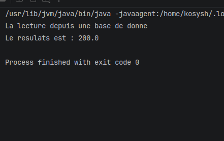
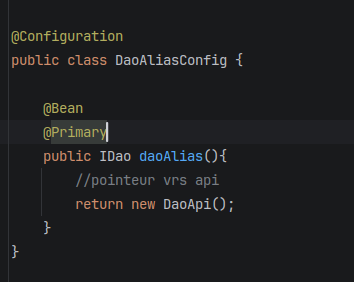
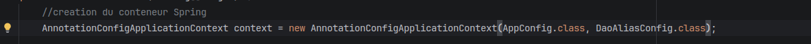
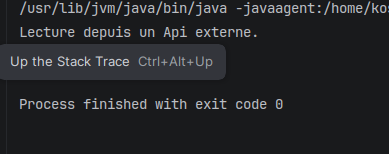
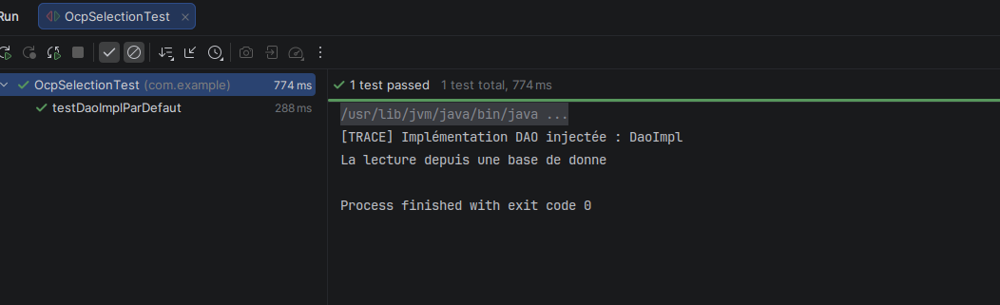

# TP3 : Spring IoC et principe OCP

Dans ce TP, nous avons utilise Spring pour choisir une implementation de `IDao` sans modifier `MetierImpl`. Les classes DAO sont declarees avec `@Component` et la classe metier avec `@Service`. `AppConfig` utilise `@ComponentScan` pour trouver ces beans et `@PropertySource` pour charger `app.properties`.

`MetierImpl` recoit un DAO par son constructeur. Sa methode `calcul()` recupere la valeur du DAO et la multiplie par 2. Les captures montrent les differentes etapes du travail.

## Premiere etape : @Primary

Nous avons d'abord ajoute `@Primary` sur `DaoImpl`. Cette annotation permet a Spring de choisir ce bean en priorite parmi les implementations de `IDao`.

`DaoImpl` retourne `100.0`. Le resultat du calcul est donc `200.0`.

## Deuxieme etape : alias avec @Bean

Nous avons ensuite cree `DaoAliasConfig`. La methode `daoAlias()` utilise `@Bean` pour declarer un bean et `@Primary` pour le choisir en priorite. Dans la capture, elle retourne `new DaoApi()`.

Pour utiliser cette configuration, nous avons charge `AppConfig` et `DaoAliasConfig` dans le contexte Spring.

La console montre que la source API est utilisee. `DaoApi` retourne `220.0`, donc le resultat du calcul est `440.0`.

Ces captures correspondent au choix de `DaoApi`. Dans le code actuel de `DaoAliasConfig`, nous avons choisi `DaoFile`, qui retourne `180.0` et donne un resultat de `360.0`.

## Troisieme etape : selection avec une propriete

Dans `app.properties`, nous avons ajoute `dao.target=daoApi`. `DynamicDaoConfig` lit cette valeur avec `@Value` et choisit le DAO avec un `switch`. Le bean retourne est declare `@Primary`.

Avec `dao.target=daoApi`, Spring injecte `DaoApi` dans `MetierImpl`. Le resultat est `440.0`.

Nous pouvons aussi choisir `dao`, `dao2` ou `daoFile`. Les resultats sont respectivement `200.0`, `300.0` et `360.0`. Les valeurs sont simulees par les DAO pour cet exercice.

Dans la version actuelle, `Main` charge `AppConfig` et `DynamicDaoConfig`. Le changement de propriete permet de choisir une autre source sans modifier le code Java. Il faut relancer l'application pour appliquer ce choix.

## Verification du DAO injecte

Nous avons ajoute une trace avec `@PostConstruct` dans `MetierImpl`. Elle affiche le nom de la classe injectee au demarrage. Ici, la trace affiche `DaoApi` et le resultat est `440.0`.

## Test avec JUnit

Nous avons cree `OcpSelectionTest` pour verifier le calcul. La capture montre le premier test reussi avec `DaoImpl` et un resultat attendu de `200.0`.

Ce premier test charge seulement `AppConfig`. Spring choisit le bean `dao` car le parametre du constructeur porte le meme nom. Ce test verifie le calcul avec `DaoImpl`, mais pas la selection par la propriete `dao.target`.

## Conclusion

Le calcul de `MetierImpl` reste le meme quand nous changeons de source. Nous avons utilise `@Primary`, un bean de configuration et une propriete pour choisir le DAO a injecter. Le choix de la dependance reste dans la configuration, ce qui permet de respecter le principe OCP pour la classe metier.
